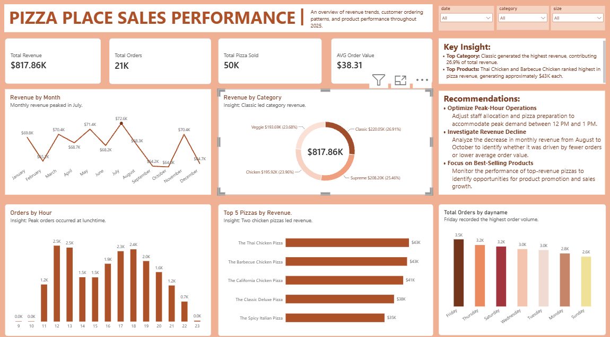

# Pizza Sales Analysis | End-to-End Data Analytics Project

## Project Overview

This project analyzes pizza restaurant sales data to evaluate business performance, identify product contributions, and understand customer ordering patterns.

The project follows an end-to-end data analytics workflow, covering data cleaning and preparation using Python, exploratory data analysis using MySQL, and data modeling and visualization using Microsoft Power BI.

The objective is to transform raw sales data into meaningful insights that can support business evaluation and decision-making.

## Business Objectives

- Evaluate overall sales performance using key performance indicators (KPIs).
- Identify monthly sales trends and fluctuations.
- Analyze product and category revenue contributions.
- Understand customer ordering patterns by hour and day of the week.
- Examine sales performance across different pizza sizes.

## Business Questions

1. What are the overall sales performance metrics, including total revenue, total orders, total pizzas sold, and average order value?
2. How do monthly orders and revenue fluctuate throughout the year?
3. Which pizza products generate the highest and lowest revenue?
4. Which pizza categories contribute the most to total revenue?
5. During which hours do customers place the most orders?
6. Which days of the week generate the highest order volume and revenue?
7. Which pizza sizes contribute most to total pizza sales?

## Dataset

The dataset consists of four CSV files containing pizza restaurant sales transactions.

| Dataset | Description |
|---|---|
| `orders.csv` | Order dates, times, and order IDs |
| `order_details.csv` | Order details, pizza IDs, and quantities |
| `pizzas.csv` | Pizza IDs, sizes, and prices |
| `pizza_types.csv` | Pizza names, categories, and ingredients |

The datasets are related through key columns to enable comprehensive sales analysis.

## Tools & Technologies

| Tool | Purpose |
|---|---|
| Python (Pandas) | Data inspection, cleaning, and transformation |
| Jupyter Notebook | Data cleaning workflow |
| MySQL | Exploratory Data Analysis (EDA) |
| Microsoft Power BI | Data modeling and dashboard development |
| DAX | Creating calculated measures and KPIs |

## Data Cleaning & Preparation (Python)

Data cleaning was performed using Python and the Pandas library.

### Data Quality Issues Identified

- Character encoding issues in `pizza_types.csv`.
- Date and time columns stored as object data types.
- Potential leading and trailing whitespace in text columns.

### Data Cleaning Steps

1. **Data Loading & Encoding Handling**
   - Loaded all four datasets using Pandas.
   - Applied `encoding="latin1"` to `pizza_types.csv` to handle character encoding issues.

2. **Data Inspection**
   - Inspected data types using `.info()`.
   - Checked missing values using `.isnull().sum()`.
   - Checked duplicate records using `.duplicated().sum()`.

3. **Datetime Conversion & Feature Engineering**
   - Converted date and time columns into appropriate datetime formats.
   - Extracted `dayname` and `order_hour` features to support time-based analysis.

4. **Text Standardization**
   - Removed leading and trailing whitespace from relevant text columns using `.str.strip()`.

5. **Export Cleaned Datasets**
   - Exported the cleaned datasets into four separate CSV files.

The cleaning process resulted in datasets with no missing values or duplicate records.

The complete cleaning process is available in [`cleaning.ipynb`](notebooks/cleaning.ipynb).

## Data Modeling (Power BI)

The four cleaned CSV datasets were imported directly into Microsoft Power BI.

Relationships were established between the tables using the Model View:

- `orders_clean` and `order_details_clean` through `order_id`.
- `order_details_clean` and `pizzas_clean` through `pizza_id`.
- `pizzas_clean` and `pizza_types_clean` through `pizza_type_id`.

The data model enables information from multiple tables to be analyzed together and supports the creation of DAX measures and interactive visualizations.

## Exploratory Data Analysis (MySQL)

Exploratory Data Analysis was performed using MySQL to examine sales performance, product contribution, and customer ordering patterns.

### 1. Sales Performance Analysis
- Calculated total revenue.
- Calculated total orders.
- Calculated total pizzas sold.
- Calculated average order value (AOV).
- Examined monthly order and revenue trends.

### 2. Product Performance Analysis
- Identified the top 5 pizza products based on revenue.
- Identified the bottom 5 pizza products based on revenue.
- Analyzed revenue contribution by pizza category.
- Examined sales performance by pizza size.

### 3. Customer Ordering Pattern Analysis
- Analyzed order volume by hour to identify peak ordering times.
- Compared order volume and revenue across days of the week.

The SQL queries used in this analysis are available in [`eda_pizza_sales.sql`](sql/eda_pizza_sales.sql).

## Data Visualization & Dashboard Development (Power BI)

Microsoft Power BI was used to develop an interactive sales dashboard based on the cleaned datasets.

DAX measures were created to calculate the main performance indicators:

- Total Revenue
- Total Orders
- Total Pizzas Sold
- Average Order Value (AOV)

The dashboard presents:

- Overall sales performance through KPI cards.
- Monthly revenue trends.
- Revenue contribution by pizza category.
- Order distribution by hour.
- Order distribution by day of the week.
- Top 5 pizza products based on revenue.

### Dashboard Preview



[Download Power BI Dashboard](dashboard/pizza_sales_dashboard.pbix)

## Key Findings

Based on the analysis and dashboard visualization, the following findings were identified:

- **Category Contribution:** The Classic category contributes approximately 26.9% of total revenue, making it the largest revenue contributor among pizza categories.
- **Monthly Performance:** July recorded the highest monthly revenue.
- **Ordering Patterns:** Customer orders are concentrated around lunchtime, particularly between 12 PM and 1 PM.
- **Day-of-Week Performance:** Friday recorded the highest order volume.
- **Product Performance:** Thai Chicken and Barbecue Chicken are notable individual products in the revenue analysis.

## Business Recommendations

Based on the findings, the following recommendations are proposed:

1. **Maintain Category Performance**

   Monitor the Classic category's revenue contribution and maintain the availability of its popular products.

2. **Optimize Lunchtime Operations**

   Prepare sufficient ingredients and staff during peak ordering hours, particularly between 12 PM and 1 PM.

3. **Evaluate Friday Operations**

   Review staffing and inventory planning to accommodate higher order volumes on Fridays.

4. **Review Product Performance**

   Monitor products with lower revenue contributions and evaluate whether menu adjustments, promotions, or product improvements are necessary.

5. **Monitor Monthly Sales Trends**

   Compare monthly sales performance to identify fluctuations and support future sales planning.

## Conclusion

This project demonstrates an end-to-end data analytics workflow, from data cleaning and preparation to exploratory analysis, data modeling, and dashboard development.

By using Python, MySQL, and Power BI, raw sales data was transformed into structured information and visual insights that help explain sales performance, product contribution, and customer ordering behavior.

The analysis provides a foundation for data-driven business evaluation and decision-making.

## Repository Structure

```text
pizza-sales-data-analyst/
│
├── data/
│   ├── raw/
│   │   ├── orders.csv
│   │   ├── order_details.csv
│   │   ├── pizzas.csv
│   │   └── pizza_types.csv
│   │
│   └── cleaned/
│       ├── orders_clean.csv
│       ├── order_details_clean.csv
│       ├── pizzas_clean.csv
│       └── pizza_types_clean.csv
│
├── notebooks/
│   └── cleaning.ipynb
│
├── sql/
│   └── eda_pizza_sales.sql
│
├── dashboard/
│   ├── pizza_sales_dashboard.pbix
│   └── pizza_sales_dashboard.png
│
└── README.md
```

## Author

**Renita Fauziah**

GitHub: [renitaafzh](https://github.com/renitaafzh)
